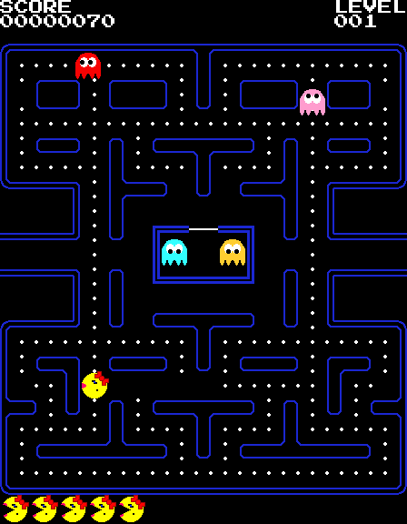
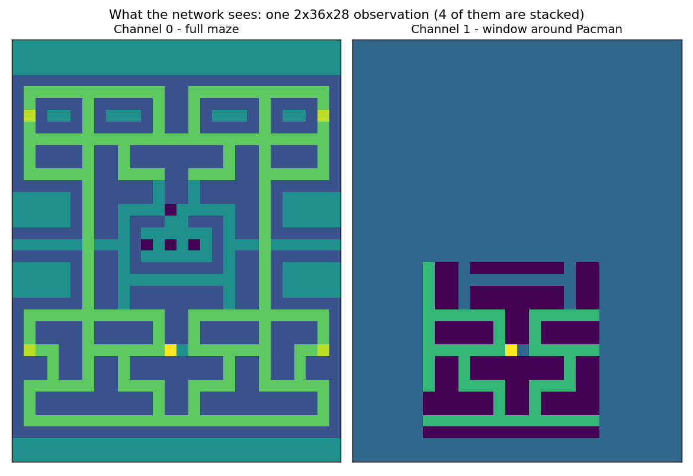
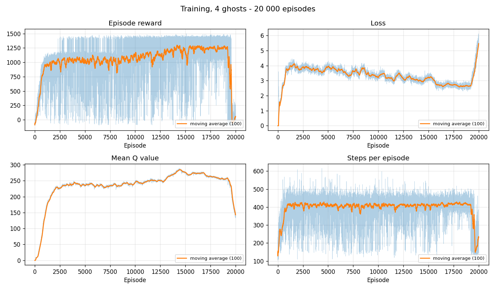
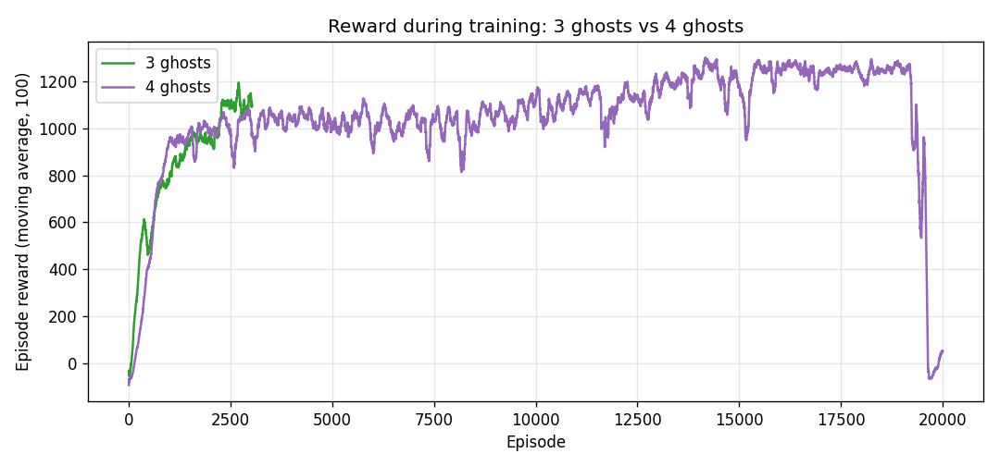

# Pacman DQN

A Pacman agent trained from scratch with deep reinforcement learning — Dueling
Double DQN with NoisyNets, prioritised replay and n-step returns — playing a
full pygame implementation of the 1980 arcade game.

<p align="center">
  
</p>

## Context

Second-year project for the Artificial Intelligence course at TELECOM Nancy
(FISE 2A, 2024–2025). The assignment was to implement a version of Pacman and
an agent that plays it, with one explicit constraint: the agent's behaviour had
to come from the AI methods seen in class, **not** from a set of hand-written
heuristic rules. Reinforcement learning was the natural fit — the agent is
given nothing but the maze, a reward signal and twenty thousand episodes to
work it out.

The game itself is a pygame implementation adapted from the tutorial at
[pacmancode.com](https://pacmancode.com/), modified so that it can be driven
one action at a time by an agent instead of by the keyboard, and so that the
number of ghosts can be chosen at startup.

## How the agent sees the game

Rather than feeding the network raw rendered pixels, each observation is built
directly from the live game objects. It has two parts.

**An image-like tensor**, shape `2 × 36 × 28`, one cell per maze tile:

| Content | Value |
| --- | --- |
| Ghost | `-1` |
| Wall | `-0.5` |
| Empty corridor | `0` |
| Pellet | `0.5` |
| Power pellet | `0.8` |
| Pacman | `1` |

Channel 0 holds the whole maze. Channel 1 repeats only a 14×14 window centred
on Pacman, leaving the rest at zero, so the network always gets a close-up of
the area it is about to move through. The whole tensor is then multiplied by
30, which moves the values away from zero before the first convolution.

<p align="center">
  
</p>

**An auxiliary vector** carrying what a single frame cannot express: the
normalised score and remaining lives, the current mode of each ghost, the
fraction of normal and power pellets still on the board, a frightened flag, the
distance to the closest pellet, and the distance from Pacman to each ghost.

Finally, a single frame says where everything is but not where it is *going*.
The last **four observations are stacked** along the channel axis, so the
network receives `8 × 36 × 28` and can read motion.

## Method

**Dueling Double DQN.** A convolutional body reads the stacked maze channels;
its flattened output is concatenated with the auxiliary vector and fed to two
heads, one estimating the state value `V(s)` and one the action advantages
`A(s, a)`. They recombine as

```
Q(s, a) = V(s) + ( A(s, a) − mean_a A(s, a) )
```

Separating the two makes the network able to say "this position is bad" without
having to attribute the badness to a particular action. The *Double* part
addresses the overestimation bias of plain Q-learning: the online network picks
the next action, the target network scores it.

```
a*     = argmax_a' Q_current(s', a')
target = r + γ · Q_target(s', a*) · (1 − done)
```

**NoisyNets instead of ε-greedy.** Exploration noise lives in the weights of
the fully connected layers (`NoisyLinear`) rather than in a hand-tuned ε
schedule, so the amount of exploration is learned and can differ per state. In
evaluation mode only the mean weights are used, which makes the policy
deterministic.

**Prioritised replay with n-step returns.** Transitions are sampled in
proportion to their TD error, with importance-sampling weights correcting the
resulting bias, and each stored transition carries the discounted return over
3 environment steps rather than 1.

### Hyperparameters

| | |
| --- | --- |
| Discount factor γ | `0.99` |
| Learning rate α | `2.5e-4`, cosine-annealed to `1e-6` |
| Optimiser | Adam, gradient norm clipped at 1.0 |
| Batch size | 64 |
| Replay capacity | 200 000, α = 0.6, β annealed from 0.4 |
| n-step | 3 |
| Frame stack | 4 |
| Gradient step every | 4 environment steps |
| Target network sync | every 5 000 environment steps |
| Warm-up before learning | 10 000 transitions |
| Loss | Smooth L1, weighted by the IS weights |

## Reward design

Most of the project's effort went here. The shaping aims to make the agent
*clear the maze* rather than merely survive, and it is what separates an agent
that circles forever in a safe corner from one that finishes a level.

The goals behind it:

- learn to eat pellets efficiently and avoid dying;
- explore actively and never stand still;
- make progress through intermediate milestones;
- avoid repetitive back-and-forth trajectories.

Concretely, per transition:

| Event | Effect |
| --- | --- |
| Normal pellet eaten | `+(100 − 95 · remaining/236)` — worth more as the maze empties |
| Power pellet eaten | `+100` each |
| Score gained beyond the pellets (ghosts, fruit) | `+50` per 200 points |
| Life lost | `−200` |
| Every step | `−0.1`, so dawdling is never free |
| 100 steps without eating | `−300` and the episode is aborted |
| Maze cleared | `+2000`, episode won |

The total is divided by 10 to keep returns in a range the network handles
comfortably.

## Results

Two configurations were trained: three ghosts (3 026 episodes) and four ghosts
(20 000 episodes). The logs behind both are in the repository, so every figure
below can be regenerated.

<p align="center">
  
</p>

Reward climbs steeply over the first ~1 000 episodes, then settles on a slow
improvement from a moving average of about 1 000 to about 1 250. The mean Q
value rises and flattens as the value estimates converge, and episodes stabilise
around 400 steps. From episode 14 000 to 19 000 the agent clears the maze in
roughly half of its training episodes.

### Why the reward collapses at the end

The last panel of every chart drops off a cliff. That collapse is real, and it
is worth explaining rather than cropping out.

| Episodes | Mean reward | Mazes cleared (out of 250) |
| --- | --- | --- |
| 14 000 – 19 000 | ~1 240 | ~100–140 |
| 19 001 – 19 250 | 1 130 | 103 |
| 19 251 – 19 500 | 848 | 87 |
| 19 501 – 19 750 | 156 | 24 |
| 19 751 – 20 000 | 16 | **0** |

So it is not a single bad episode but a run-away over the last ~750 episodes,
following a 5 000-episode plateau. The last maze was cleared at episode 19 562.

Two explanations can be ruled out from the logs. The win log timestamps every
winning episode, and the game runs at a steady 7.4 ms per agent step from
episode 2 000 to the very end — the simulation did not slow down, so this is not
a frame-rate artefact. The episode numbers are strictly consecutive from 1 to
20 000, so training was never interrupted and resumed either.

The order in which the metrics break is the informative part:

1. **~19 234** — reward and episode length fall first;
2. **~19 396** — the loss starts rising, 2.6 → 5.4;
3. **~19 639** — the mean Q value drops last, 255 → 147.

That is the opposite of a numerical blow-up. Had the Q values diverged and
broken the policy, Q and the loss would have moved *before* the behaviour. Here
the policy degrades first and the value estimates follow: once the agent stops
clearing mazes, the `+2000` terminal rewards disappear from the sampled batches,
the targets drop, and the Q estimates drop with them.

The likely cause is the deadly triad — bootstrapping, function approximation and
off-policy replay — hitting at the worst possible moment. The cosine schedule
has annealed the learning rate to `2.5e-6` by episode 19 000 and `1e-6` at the
end, 100 to 250 times smaller than its initial value. The network can no longer
correct its own errors, yet Adam keeps taking steps of roughly that magnitude in
whatever direction the gradient points, and the loop is self-reinforcing: a
slightly worse policy fills the replay buffer with worse episodes, which lowers
the targets, which worsens the policy. Three details of this implementation feed
it: the n-step buffer is never cleared between episodes, so each episode
boundary stores two transitions whose 3-step return straddles a reset;
prioritised replay concentrates the gradient on the largest TD errors, which
late in training are exactly those odd transitions; and NoisyNet exploration is
never annealed, so the agent is still acting under parameter noise on its last
episode.

The practical consequence matters more than the diagnosis: the training loop
overwrites a single checkpoint every 100 episodes and never evaluates the policy
it is saving, so the final file on disk is the collapsed agent, not the best
one. The weights shipped here (`modele_final.pth`) were taken before the
collapse. Adding a periodic greedy evaluation and keeping the best checkpoint
would have avoided losing the good policy, and is the first thing this training
loop needs.

<p align="center">
  
</p>

Adding the fourth ghost costs surprisingly little in final reward; it mostly
costs time, the four-ghost run needing several times as many episodes to reach
a comparable level.

Each cleared maze is appended to a win log, so victories can be counted
directly (`python -m agent.count_wins --ghosts 4`). In the shipped evaluation
log, the three complete 100-episode runs it contains ended with 62, 63 and 50
cleared mazes. Be aware that this file accumulates across runs rather than
being reset, so it has to be read run by run.

### What would come next

- evaluate greedily every N episodes and keep the best checkpoint, so a late
  collapse can no longer cost the good policy;
- rebalance the weights inside the reward function;
- reward the exploration of unvisited areas more strongly;
- vary the maze during training instead of always using the same one;
- add partial resets, for instance a randomised starting position;
- start from smaller levels or fewer pellets, i.e. curriculum learning.

## Repository layout

```
Pacman_Complete/
├── agent/                  the reinforcement learning agent
│   ├── config.py           per-experiment settings (3 vs 4 ghosts)
│   ├── environment.py      gym environment: observations and reward
│   ├── game_bridge.py      drives the game one action at a time
│   ├── frame_stack.py      stacks the last k observations
│   ├── networks.py         NoisyLinear and the dueling Q-network
│   ├── replay.py           prioritised replay with n-step returns
│   ├── train.py            training loop
│   ├── evaluate.py         plays a trained policy, reports the win rate
│   ├── plot_metrics.py     redraws the training curves from a log
│   ├── count_wins.py       counts the entries of a win log
│   └── maze.py             reads wall positions from the maze files
├── IA_3_fantomes/          logs of the 3-ghost run
├── IA_4_fantomes/          weights and logs of the 4-ghost run
├── run.py                  game controller
├── pacman.py, ghosts.py, nodes.py, pellets.py, ...   game engine
└── maze1.txt, spritesheet_mspacman.png, ...          game assets
docs/                       figures used in this README
```

The two experiments share every line of the agent code and differ only through
the `AgentConfig` objects in `agent/config.py`.

## Running it

Requires Python 3.10+ and a CUDA-capable GPU for evaluation.

```bash
pip install -r requirements.txt
cd Pacman_Complete
```

All commands are run from `Pacman_Complete`, because the game loads its assets
and writes its logs by relative path.

```bash
# play the game yourself, with the arrow keys
python run.py

# train an agent (4 ghosts by default)
python -m agent.train --ghosts 4

# play a trained policy and report the win rate
python -m agent.evaluate --ghosts 4 --episodes 100

# redraw the training curves of a run
python -m agent.plot_metrics --ghosts 4

# count the victories recorded in a win log
python -m agent.count_wins --ghosts 4
```

## What is and is not in this repository

Included: the full game, the full agent, the training and win logs of both
runs, and `IA_4_fantomes/modele_final.pth` — the 5 MB set of weights the
four-ghost results were produced with.

Not included: the seven other checkpoints saved during training (another
~40 MB of intermediate and superseded weights), and `policy_only.pth`, which
`agent/evaluate.py` regenerates from `modele_final.pth` on first run.

## Credits

The game is adapted from the Pacman implementation tutorial at
[pacmancode.com](https://pacmancode.com/). The agent, the observation
encoding, the reward function and the training pipeline are the project's own
work.
